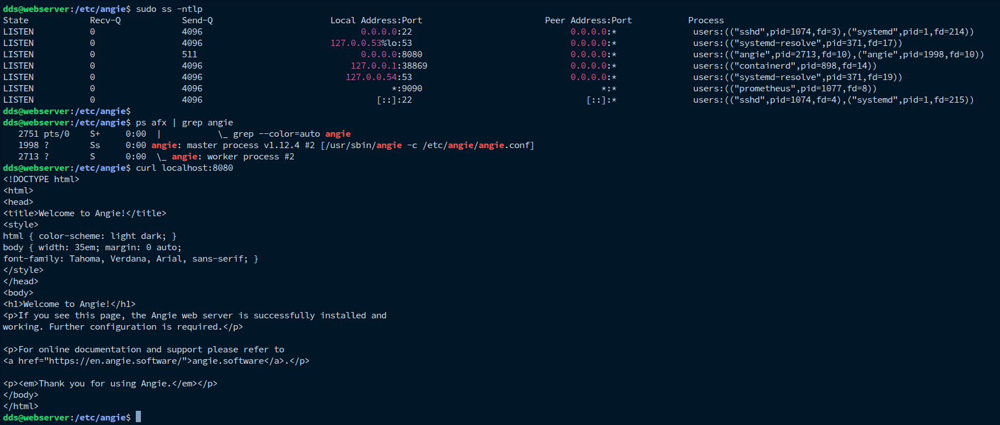
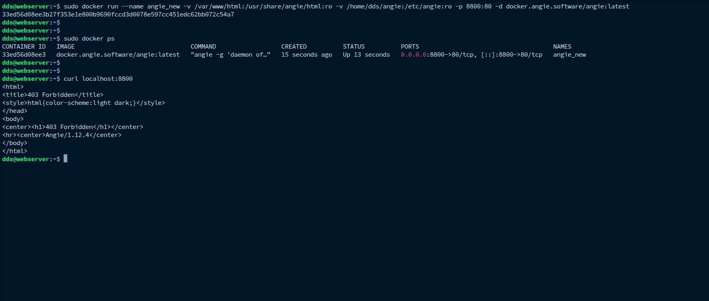

# Домашняя работа. Установка Angie

## Цель:

    1. провести установку актуальной версии Angie на виртуальную машину различными способами.

### Описание выполнения домашнего задания

#### Установка из пакетов

Работу выполняю на ВМ с установленной Debian, Ubuntu

Установил вспомогательные пакеты для подключения репозитория Angie:

    sudo apt-get update
    sudo apt-get install -y ca-certificates curl

Скачал открытый ключ репозитория Angie для проверки подлинности пакетов:

    sudo curl -o /etc/apt/trusted.gpg.d/angie-signing.gpg \
                https://angie.software/keys/angie-signing.gpg

Подключил репозиторий Angie:

    echo "deb https://download.angie.software/angie/$(. /etc/os-release && echo "$ID/$VERSION_ID $VERSION_CODENAME") main" \
        | sudo tee /etc/apt/sources.list.d/angie.list > /dev/null

Обновил индексы репозиториев:

    sudo apt-get update

Установил пакет Angie:

    sudo apt-get install -y angie

Изменил настройки Angie сменив порт со стандартного 80 на 8080:
    
    sudo nano ./http.d/default.conf
    
Проверил конфигурацию:

    sudo angie -t

Перезагрузил сервис:
    
    sudo service angie reload

Проверил сетевые соединения:   
    
    sudo ss -ntlp

Проверил работу:

    curl localhost:8080

#### Установка в Docker

Имея установленный Docker запустил контейнер c Angie на порту 8800, открыв ему доступ на чтение к каталогу со статическими файлами /var/www/ и файлу конфигурации angie.conf, лежащему в текущем рабочем каталоге:

    dds@webserver:~$ sudo docker run --name angie_new -v /var/www/html:/usr/share/angie/html:ro -v /home/dds/angie:/etc/angie:ro -p 8800:80 -d docker.angie.software/angie:latest

