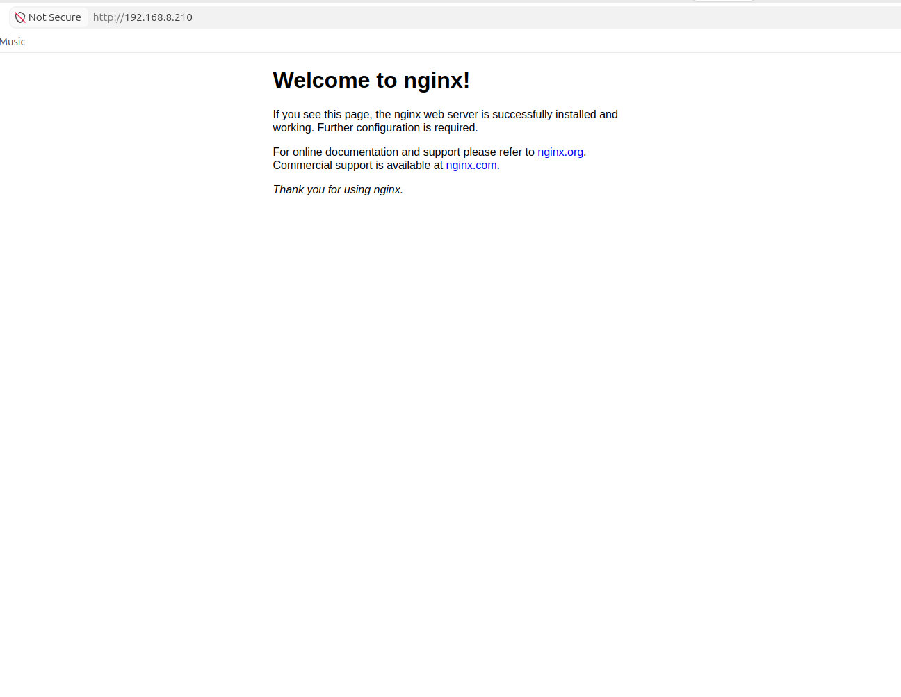
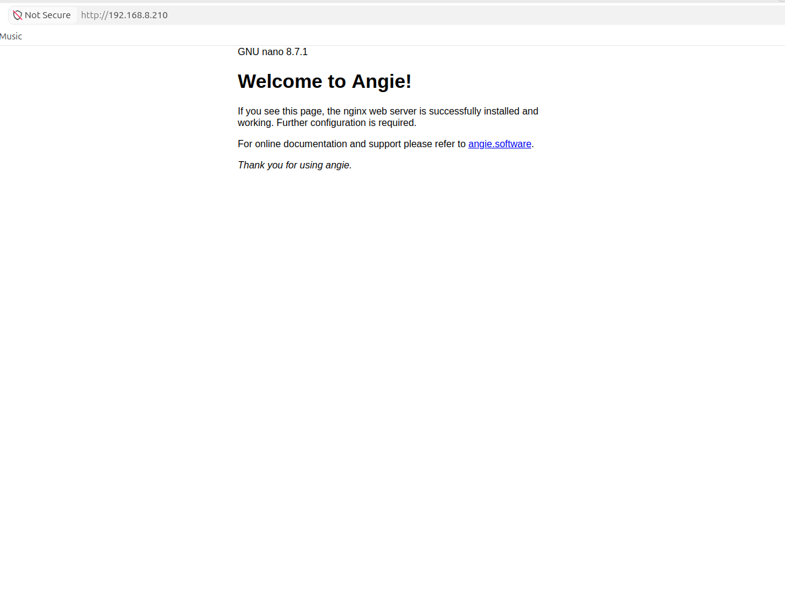

# Домашняя работа. Миграция из Nginx в Angie

## Цель:

    1. научиться переводить готовые конфигурации для Nginx в конфигурацию Angie.

### Описание выполнения домашнего задания

Остановил Angie, ранее установленный на сервере.
Установил Nginx. Взял готовый набор конфигов для Nginx. 

    @webserver:/etc/angie$ sudo nginx -t
    nginx: the configuration file /etc/nginx/nginx.conf syntax is ok
    nginx: configuration file /etc/nginx/nginx.conf test is successful

Запустил Nginx на сервере. Страница открывается 

Скопировал конфигурацию nginx в /etc/angie/ целиком:

    sudo rsync -a --no-links /etc/nginx/ /etc/angie/

Оставив копию настрек Angie, скопировал настройки nginx

    sudo mv /etc/angie/nginx.conf /etc/angie/angie.conf

Исправил пути для include и путь к PID-файлу, к журналу доступа и журналу ошибок:

Виртуальные хосты подключаются из sites-enabled/, так что восстановил ссылки
    
    sudo ln -s /etc/angie/sites-available/default \
                /etc/angie/sites-enabled/default

Так как ранее я установил динамические модули Brotli:

    load_module modules/ngx_http_brotli_filter_module.so;
    load_module modules/ngx_http_brotli_static_module.so;

Прверил папку на следы nginx.

Проверил конфигурацию: 

    sudo angie -t
    angie: the configuration file /etc/angie/angie.conf syntax is ok
    angie: configuration file /etc/angie/angie.conf test is successful

Остановил nginx и запустил angie:

    sudo systemctl stop nginx && sudo systemctl start angie

    curl -I localhost
    HTTP/1.1 200 OK
    Server: Angie/1.12.4
    Date: Thu, 19 Nov 2026 18:28:59 GMT
    Content-Type: text/html

А т.к. я поменял html страницу, то картинка в браузере после обновления тоже изменилась:

